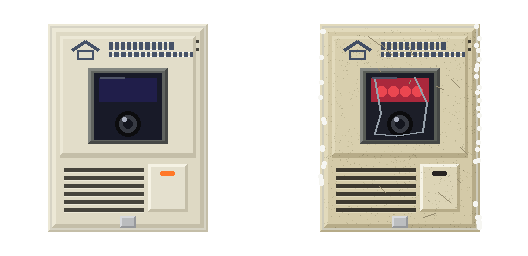

# QWERTY's Model

실제 기기를 마인크래프트 블록으로 옮기는 모드입니다. (Minecraft 1.20.1 / Forge 47.x)

## 수록 모델

### HT-100 도어카메라 / HT-100 도어카메라 (철거품)
아파트 세대 현관 옆에 붙는 도어카메라(초인종 겸 카메라)입니다.

- **설치**: 벽 옆면에 붙여 설치합니다. 붙어 있던 벽이 사라지면 아이템으로 떨어집니다.
- **구성**: 벽 브래킷, 본체, 상단 커버(로고·창), 카메라 창, 렌즈, 호출 버튼, 하단 걸쇠, 스피커 그릴, 마이크 구멍
- **호출 버튼**: 오른쪽 아래 사각 버튼을 우클릭하면 "띵동" 차임이 울리고 버튼 LED가 켜집니다. 약 1.6초 동안 레드스톤 신호 15를 냅니다(붙은 벽 블록에도 강한 신호). 레드스톤으로 문, 램프, 다른 모드의 장치와 연결할 수 있습니다.
- **야간 적외선 LED**: 앞면을 웅크리고 우클릭하면 켜고 끕니다. 켜지면 창 윗부분이 붉게 빛나고 약한 빛(3)을 냅니다.
- **철거품 버전**: 누렇게 바랜 본체, 들뜬 보호필름, 브래킷의 페인트 자국까지 표현했습니다.

### 조합법
- 도어카메라: 흰색 테라코타 6 + 색유리 1 + 레드스톤 1 + 돌 버튼 1 (C G C / C R C / C B C)
- 철거품: 도어카메라 + 흙 (무형 조합)

## 빌드
`main`에 푸시하면 GitHub Actions가 jar를 빌드합니다. **Actions → 최신 실행 → Artifacts → `qwertys_model-jar`** 에서 받으세요.

로컬에서 빌드하려면 JDK 17과 Gradle 8.1.1로 `gradle build` 를 실행하면 `build/libs/` 에 jar가 생깁니다.

## 텍스처·모델 다시 만들기
`python3 tools/gen_assets.py` 를 실행하면 텍스처, 블록 모델, 블록스테이트, 아이템 모델이 다시 생성됩니다(Pillow 필요). 색이나 부품 치수는 이 스크립트 상단에서 바꿀 수 있습니다.
